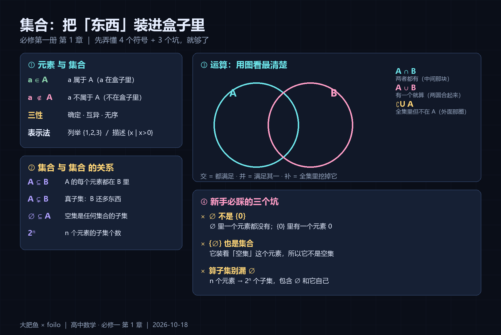
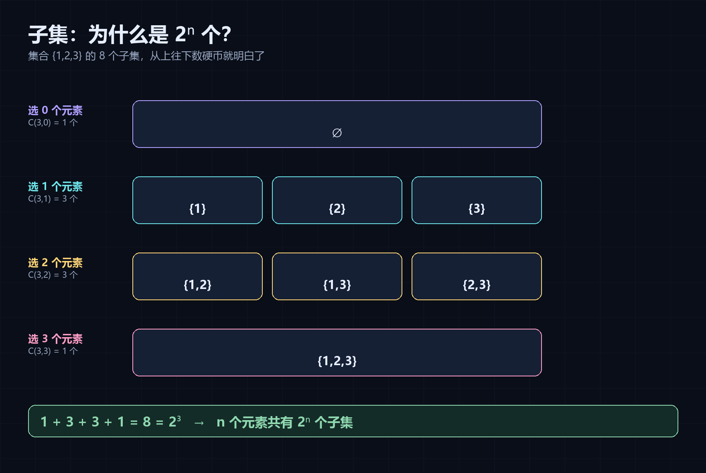
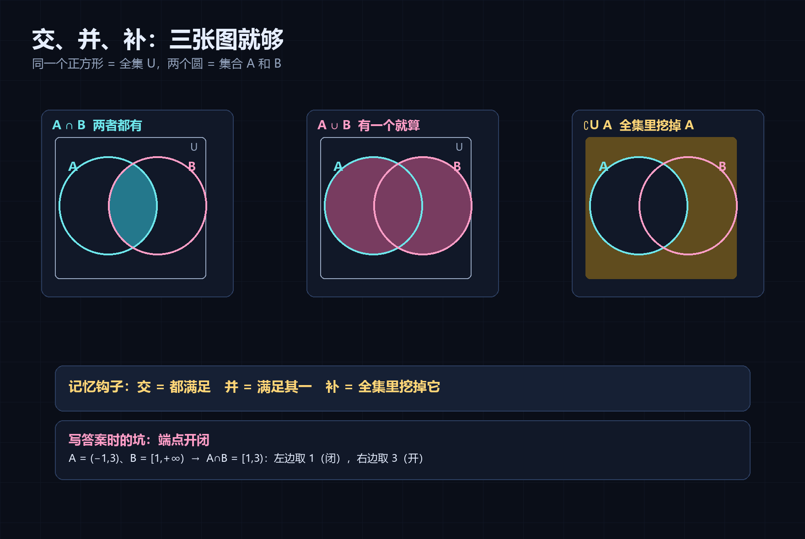

# 集合与常用逻辑用语（入门笔记）

> 高中数学 · 必修第一册 第 1 章 ｜ 整理：大肥鱼 × foilo
> 先看图，再看字。图在 `img/集合-四种运算与三个坑.png`

## 一、集合是什么

**集合**就是把一些确定的对象装进一个"盒子"里。盒子里的每个对象叫**元素**。

- 元素 $a$ 在集合 $A$ 里：$a \in A$
- 不在：$a \notin A$

### 元素的三个性质（判断能不能成为集合）

| 性质 | 意思 | 反例 |
| --- | --- | --- |
| 确定性 | 给一个对象，能明确判断在不在 | "高个子同学"❌ |
| 互异性 | 同样的元素只算一个 | $\{1,1,2\}$ 应写成 $\{1,2\}$ |
| 无序性 | 顺序无关 | $\{1,2\}=\{2,1\}$ |

## 二、怎么表示

- **列举法**：$\{1,2,3\}$、$\{a,b,c\}$ —— 元素少、能数清时用
- **描述法**：$\{x \mid x>0\}$、$\{x \in \mathbb{R} \mid x^2=1\}$ —— 元素多或有条件时用

> 描述法的格式：`{ 代表元素 | 满足的条件 }`。竖线前面是"这是什么"，后面是"它要满足什么"。

## 两张配套图

**子集为什么是 2ⁿ 个**（按"选几个元素"分层数）：

**交并补到底涂哪一块**：

## 三、集合之间的关系

- **子集** $A \subseteq B$：$A$ 里的每个元素都在 $B$ 里
- **真子集** $A \subsetneq B$：$A \subseteq B$ 且 $B$ 里还有 $A$ 没有的元素
- **相等** $A = B$：互相都是子集

**两个必须记住的结论**：

1. **空集是任何集合的子集**：$\varnothing \subseteq A$
2. 含 $n$ 个元素的集合，共有 $2^n$ 个子集，其中真子集 $2^n-1$ 个（去掉它自己），非空子集 $2^n-1$ 个（去掉空集）

## 四、三种运算

设全集为 $U$：

| 运算 | 记号 | 意思 | 图上看 |
| --- | --- | --- | --- |
| 交集 | $A \cap B$ | 两个都有的元素 | 两圆重叠那块 |
| 并集 | $A \cup B$ | 至少在一个里 | 两圆合起来的全部 |
| 补集 | $\complement_U A$ | 全集里但不在 $A$ | 圆外面的部分 |

**常用恒等式**（解题时能省时间）：

$$A \cap A = A,\quad A \cup A = A,\quad A \cap \varnothing = \varnothing,\quad A \cup \varnothing = A$$
$$\complement_U(\complement_U A) = A,\quad A \cap (\complement_U A) = \varnothing,\quad A \cup (\complement_U A) = U$$

## 五、四个高频易错点

### 1. $\varnothing$、$\{0\}$、$\{\varnothing\}$ 完全不同

- $\varnothing$：一个元素都没有
- $\{0\}$：有一个元素，是数字 0
- $\{\varnothing\}$：有一个元素，是"空集"这个东西

### 2. 求子集时漏掉 $\varnothing$ 和它自己

问"$\{1,2\}$ 的所有子集"：$\varnothing,\{1\},\{2\},\{1,2\}$ —— **4 个**，别只写 3 个。

### 3. 空集是任何集合的子集，但**不是**任何集合的元素

$\varnothing \subseteq A$ 永远成立；$\varnothing \in A$ 要看 $A$ 里有没有它。

### 4. 集合运算里"或/且"和"并/交"要对应

- **或** → 并集（满足一个就进来）
- **且** → 交集（都得满足）
- **不等于** → 补集（把等于的挖掉）

## 六、例题

**例 1**　已知 $A=\{x \mid -1<x<3\}$，$B=\{x \mid x\ge 1\}$，求 $A\cap B$、$A\cup B$。

答案

数轴上画：$A$ 是 $(-1,3)$，$B$ 是 $[1,+\infty)$。

- $A\cap B = [1,3)$
- $A\cup B = (-1,+\infty)$

注意端点开闭：$A$ 两端都开，$B$ 左端闭 → 交集左端取 $1$（闭），右端取 $3$（开）。

**例 2**　若 $A=\{1,2,3\}$，$B=\{x \mid x \subseteq A\}$，求 $B$ 的元素个数。

答案

$B$ 的元素是 $A$ 的**子集**，$A$ 有 3 个元素 → 子集 $2^3=8$ 个，所以 $|B|=8$。
（这题考的是"把子集本身当成元素"）

## 七、下一章

**常用逻辑用语**：充分条件、必要条件、充要条件、全称量词与存在量词。
一句话预告：**"若 p 则 q"成立时，p 是 q 的充分条件，q 是 p 的必要条件**。
